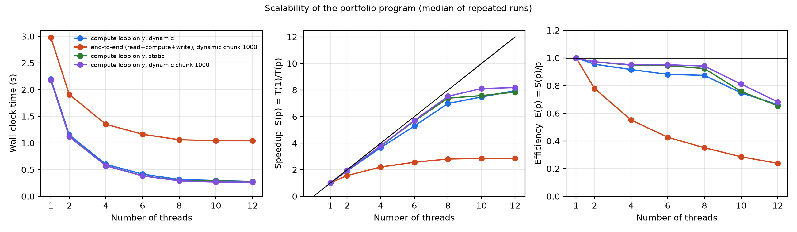
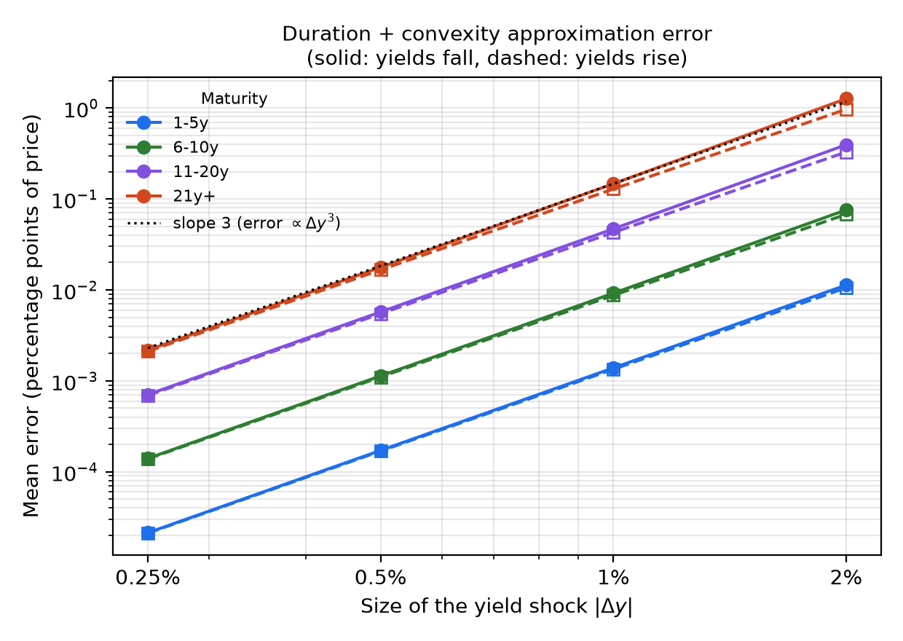
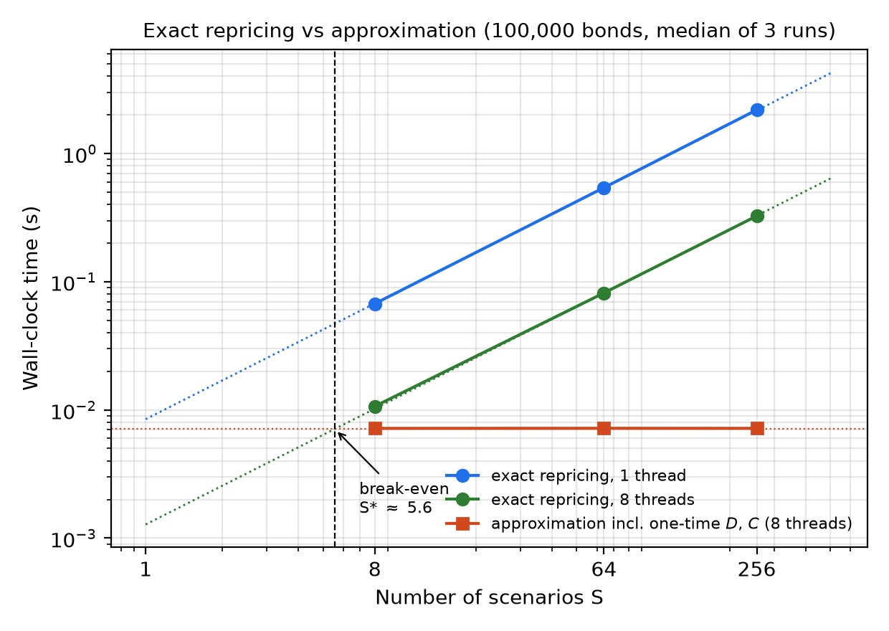
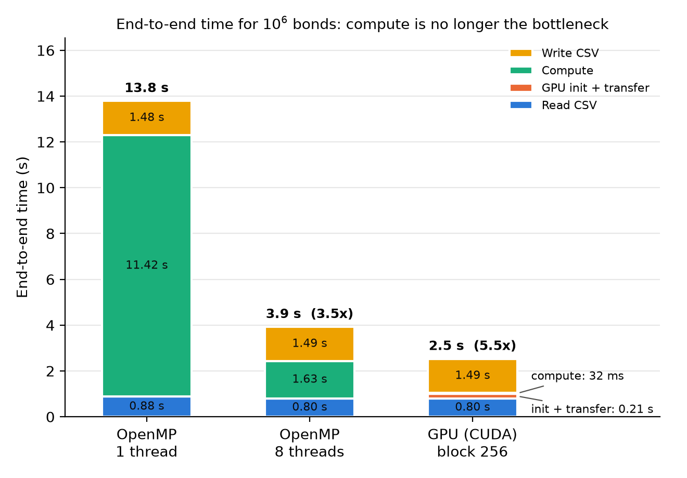

# Parallel Bond Risk: Yield-to-Maturity, Duration and Convexity with OpenMP and CUDA

CS596 Scientific Computing and Visualization, final project (USC). Yen Jung (Emily) Chen.

Full title: _Parallelizing Yield-to-Maturity Solving and Interest-Rate Risk Analysis for Large Bond Portfolios_

## Abstract

**Problem.** Banks and funds hold portfolios of tens of thousands of bonds and must recompute every bond's yield to maturity (YTM) and its price sensitivity (duration and convexity) whenever interest rates move. **However, YTM has no closed-form solution, so every bond needs its own iterative solve, and it is unclear whether the classic duration–convexity shortcut for repricing is still needed once parallel hardware makes full repricing cheap.**

**Finding.** I implement the pipeline in C with OpenMP and CUDA. The per-bond compute loop scales well: with `schedule(dynamic, 1000)` it reaches a 7.5× speedup (94% efficiency) on 8 threads for 10⁶ bonds on an Apple M4 Pro. Comparing exact repricing with the duration–convexity approximation shows that the approximation error is third order in the yield shock, so it is accurate only for small shocks and short bonds. Computing duration and convexity costs about as much as 6 exact scenarios, after which the approximation is up to 45× faster (256 scenarios). Parallel hardware speeds up both methods by almost the same factor, so it does not change this break-even. On a Tesla P100 GPU the computation is 53× faster than 8 CPU threads, but the whole program is only 1.55× faster, because reading and writing the CSV files is sequential, as Amdahl's law predicts.

**So what.** The approximation is still worth using for many scenarios with small shocks. For large shocks or long-maturity bonds, exact repricing is needed, and on parallel hardware it is cheap when the number of scenarios is small.

## Research question and answer

Once parallel hardware makes repricing cheap, is the duration–convexity approximation (ΔP/P ≈ −D·Δy + ½·C·Δy²) still worth using?

| Question                                             | Answer (this project)                                                                                                                                                                                                                                               |
| ---------------------------------------------------- | ------------------------------------------------------------------------------------------------------------------------------------------------------------------------------------------------------------------------------------------------------------------- |
| **Accuracy.** How large is the error?                | Third order in the shock: halving the shock divides the error by about 8. It grows with maturity. At −2% the mean error is 1.26 percentage points of price for bonds of 21 years or more, and 0.011 for 1–5 years. For ±0.25% it is below 0.0022 on every maturity. |
| **Cost.** When does the approximation pay off?       | Its one-time cost (computing D and C for every bond) equals about 6 exact scenarios (break-even S\* ≈ 6). At S = 256 scenarios it is about 45× faster.                                                                                                              |
| **Parallelism.** Does parallel hardware change this? | No. OpenMP speeds up exact repricing by 6.3–6.7× and the computation of D and C by 7.3×, so the break-even barely moves (6.0 with one thread, 5.6 with eight).                                                                                                      |
| **GPU.** What does the GPU add?                      | The computation is 371× faster than one thread and 53× faster than eight threads, but the end-to-end speedup is only 5.5× (1.55× over eight threads), because the CSV read and write take about 91% of the GPU run.                                                 |

## Key figures

**Fig. 7. OpenMP scaling** (Apple M4 Pro, N = 10⁶): time, speedup and efficiency versus thread count for three schedules, and for the whole program including file I/O.



**Fig. 8. Accuracy of the approximation.** Mean error of the duration–convexity formula against exact repricing versus the size of the yield shock. The curves are parallel to the dotted slope-3 line (error ∝ Δy³), and the error is larger for longer maturities.



**Fig. 9. Cost.** Running time versus the number of scenarios S (N = 100,000). The approximation includes the one-time cost of computing D and C, so it is almost flat; the cost of exact repricing grows linearly. The lines cross at about 6 scenarios.



**Fig. 10. GPU end-to-end time** (Tesla P100 on Discovery, N = 10⁶), split into CSV read, GPU initialization and transfer, computation, and CSV write. Once the computation is accelerated, the serial CSV I/O dominates.



## Repository layout

| File                                                          | Purpose                                                                                                                                                                                |
| ------------------------------------------------------------- | -------------------------------------------------------------------------------------------------------------------------------------------------------------------------------------- |
| `1.ytm.c`, `1.ytm.h`                                          | Bond price, derivative, bisection and Newton–Raphson YTM solvers (with `_iter` variants that report iteration counts)                                                                  |
| `2.duration_convexity.c`, `.h`                                | Duration and convexity by central finite differences                                                                                                                                   |
| `3.gen_portfolio.py`                                          | Generates a synthetic portfolio `bonds.csv` (each bond priced from a known yield)                                                                                                      |
| `3.portfolio.c`                                               | Reads `bonds.csv`, solves YTM, duration and convexity with OpenMP, writes `results.csv`; prints compute and end-to-end times                                                           |
| `4.plot_DC_curve.py`                                          | Plots portfolio duration/convexity and a price–yield curve                                                                                                                             |
| `5.convergence.c`                                             | Compares bisection and Newton–Raphson on the whole portfolio                                                                                                                           |
| `6.plot_scalability.py`                                       | Plots time, speedup and efficiency versus thread count from `scaling.csv`                                                                                                              |
| `6.summarize_scaling.py`                                      | Prints the speedup and Amdahl tables from `scaling.csv`                                                                                                                                |
| `7.scenario.c`                                                | Scenario analysis: exact repricing (A), per-bond approximation (B) and aggregated approximation (B-agg); accuracy and timing; writes `scenario_accuracy.csv` and `scenario_timing.csv` |
| `7.plot_scenario.py`                                          | Plots `fig/scenario_error.png` and `fig/scenario_time.png`                                                                                                                             |
| `8.portfolio.cu`                                              | CUDA version of `3.portfolio.c` (one thread per bond); prints kernel and end-to-end times, the Newton iteration histogram and the warp efficiency, and compares with `results.csv`     |
| `8.plot_gpu.py`                                               | Reads `cuda_run.out`; plots `fig/gpu_breakdown.png` and prints the results table                                                                                                       |
| `cuda_run.sl`                                                 | Slurm script for USC CARC Discovery: runs OpenMP (1 and 8 threads) and the GPU version (128, 256, 512 threads per block)                                                               |
| `cuda_run.out`                                                | Raw output of the Discovery run reported below                                                                                                                                         |
| `run_scaling.sh`                                              | Runs `./portfolio` for several thread counts and OpenMP schedules (5 runs each) and writes `scaling.csv`                                                                               |
| `scaling.csv`, `scenario_accuracy.csv`, `scenario_timing.csv` | Raw measurements                                                                                                                                                                       |
| `test_project.c`                                              | Unit tests (`make test`)                                                                                                                                                               |
| `Makefile`                                                    | Build and test targets                                                                                                                                                                 |
| `fig/`                                                        | Figures used in this README and the report                                                                                                                                             |
| `report/`                                                     | Written report                                                                                                                                                                         |

`bonds.csv`, `results.csv` and `results_gpu.csv` are generated files and are not tracked in git.

## Requirements

- A C compiler with OpenMP. macOS: `brew install libomp` (the Makefile uses clang with libomp). Linux: `gcc`.
- Python 3 with `numpy`, `pandas` and `matplotlib` (data generation and plots). `tabulate` is optional (prettier tables in `6.summarize_scaling.py`).
- For the GPU version: an NVIDIA GPU and the CUDA toolkit (`nvcc`). On USC CARC Discovery: `module purge; module load usc; module load cuda`.

## Build and run

```bash
make test                 # unit tests
make data N=1000000       # generate bonds.csv with N bonds
make                      # build ./portfolio and ./convergence

# Solve all bonds; prints compute time and end-to-end time, writes results.csv.
# The loop uses schedule(runtime): choose it with OMP_SCHEDULE.
OMP_SCHEDULE="dynamic,1000" OMP_NUM_THREADS=8 ./portfolio

./convergence                     # bisection vs Newton on the whole portfolio
python3 4.plot_DC_curve.py        # figures from bonds.csv and results.csv

./run_scaling.sh                  # all thread counts and schedules -> scaling.csv (about 3 minutes)
python3 6.plot_scalability.py     # fig/scaling.png
python3 6.summarize_scaling.py      # tables below

make scenario && ./scenario       # exact repricing vs approximation -> scenario_*.csv
python3 7.plot_scenario.py        # fig/scenario_error.png, fig/scenario_time.png
```

`run_scaling.sh` can be adjusted with environment variables, for example `THREADS="1 2 4 8" SCHEDULES="static" REPS=3 ./run_scaling.sh`. Set `APPEND=1` to add rows to an existing `scaling.csv`.

**GPU (USC CARC Discovery).** Copy this folder and `bonds.csv` to Discovery, then:

```bash
module purge; module load usc; module load cuda
make portfolio
nvcc -O2 -o portfolio_gpu 8.portfolio.cu
sbatch cuda_run.sl                # writes cuda_run.out
python3 8.plot_gpu.py             # fig/gpu_breakdown.png and the results table
```

`./portfolio_gpu [threads_per_block]` uses 256 threads per block by default.

## Results

### 1. OpenMP on one machine (Apple M4 Pro)

All numbers in this section and in Section 2 were measured on an Apple M4 Pro (12 cores: 8 performance, 4 efficiency). Each value is the median of five runs (three for the scenario timings). "Compute" timers cover only the parallel loop; "end-to-end" covers reading `bonds.csv`, computing and writing `results.csv`.

**Sequential baseline** (one thread, compute loop only, `schedule(dynamic, 1000)`)

| N         | time (s) | µs per bond |
| --------- | -------- | ----------- |
| 1,000     | 0.002191 | 2.19        |
| 10,000    | 0.022126 | 2.21        |
| 100,000   | 0.219878 | 2.20        |
| 1,000,000 | 2.207767 | 2.21        |

The cost per bond is constant, so the time grows linearly with N.

**Compute-loop speedup S and efficiency E for three OpenMP schedules** (N = 1,000,000)

| threads | dynamic (chunk 1) S / E | static S / E  | dynamic (chunk 1000) S / E |
| ------- | ----------------------- | ------------- | -------------------------- |
| 1       | 1.00 / 100.0%           | 1.00 / 100.0% | 1.00 / 100.0%              |
| 2       | 1.91 / 95.5%            | 1.94 / 97.1%  | 1.94 / 97.2%               |
| 4       | 3.66 / 91.6%            | 3.79 / 94.8%  | 3.80 / 95.1%               |
| 6       | 5.29 / 88.2%            | 5.67 / 94.5%  | 5.70 / 95.1%               |
| 8       | 6.99 / 87.4%            | 7.39 / 92.3%  | 7.53 / 94.1%               |
| 10      | 7.48 / 74.8%            | 7.58 / 75.8%  | 8.11 / 81.1%               |
| 12      | 7.95 / 66.3%            | 7.85 / 65.4%  | 8.19 / 68.3%               |

- With the default chunk of 1, dynamic scheduling pays a scheduling cost for every bond (each bond takes only about 2 µs); handing out 1,000 bonds at a time removes most of it.
- Beyond 8 threads, dynamic scheduling with a large chunk is the best. This is consistent with the 4 slower efficiency cores, which dynamic scheduling balances automatically (not measured directly).

**End to end** (`schedule(dynamic, 1000)`, N = 1,000,000)

| threads | total (s) | read (s) | compute (s) | write (s) | speedup | Amdahl predicted |
| ------- | --------- | -------- | ----------- | --------- | ------- | ---------------- |
| 1       | 2.978     | 0.340    | 2.179       | 0.452     | 1.00    | 1.00             |
| 2       | 1.909     | 0.333    | 1.121       | 0.459     | 1.56    | 1.58             |
| 4       | 1.351     | 0.326    | 0.573       | 0.450     | 2.20    | 2.23             |
| 6       | 1.163     | 0.328    | 0.382       | 0.450     | 2.56    | 2.58             |
| 8       | 1.061     | 0.326    | 0.289       | 0.442     | 2.81    | 2.80             |
| 10      | 1.042     | 0.325    | 0.269       | 0.443     | 2.86    | 2.95             |
| 12      | 1.042     | 0.329    | 0.266       | 0.446     | 2.86    | 3.06             |

Reading and writing the CSV files take about 0.79 s regardless of the thread count (26.6% of the single-thread run). With s = 0.266, Amdahl's law gives a speedup bound of 1/s ≈ 3.8×. The prediction `1 / (s + (1 − s)/p)` uses only the one-thread run and matches the measurement at 8 threads (2.80 vs 2.81); at 12 threads it is optimistic because the compute loop itself is then only 68% efficient.

See Fig. 7 above for the scaling curves.

**Bisection vs Newton–Raphson** (N = 100,000, tolerance 1e-8 for both)

| method    | avg iterations | max iterations | time (s) | max abs error vs true YTM |
| --------- | -------------- | -------------- | -------- | ------------------------- |
| bisection | 27.00          | 27             | 0.185039 | 7.451e-09                 |
| newton    | 4.43           | 7              | 0.139508 | 1.407e-15                 |

Newton needs about 6× fewer iterations but is only about 1.3× faster in wall-clock time, because each iteration evaluates both the price and its derivative.

### 2. Scenario analysis: exact repricing vs approximation (Apple M4 Pro)

Parallel yield shifts Δy of ±0.25%, ±0.5%, ±1% and ±2% are applied to the whole portfolio. **A** reprices every bond exactly (cost N·S for N bonds and S scenarios). **B** applies ΔP/P ≈ −D·Δy + ½·C·Δy² to each bond. **B-agg** gives the same result as B (identical up to rounding), but sums the portfolio's dollar duration and dollar convexity once, so each extra scenario costs O(1).

**Accuracy** (N = 10⁶; mean |approximation − exact| of ΔP/P, in percentage points of price, by maturity bucket; yields fall)

| shock  | 1–5y    | 6–10y   | 11–20y  | 21y+    | all     |
| ------ | ------- | ------- | ------- | ------- | ------- |
| −0.25% | 0.00002 | 0.00014 | 0.00071 | 0.00218 | 0.00102 |
| −0.50% | 0.00017 | 0.00114 | 0.00573 | 0.01775 | 0.00833 |
| −1.00% | 0.00139 | 0.00921 | 0.04696 | 0.14710 | 0.06875 |
| −2.00% | 0.01132 | 0.07580 | 0.39434 | 1.26463 | 0.58718 |

The error grows by a factor of about 8 each time the shock doubles (third order), and it is larger for longer maturities and for yield decreases than for increases (see `scenario_accuracy.csv` for all shocks). If an error of 0.01 percentage points of price is acceptable, the approximation is good for shocks up to ±0.25% on all maturities and up to ±1% on bonds up to 10 years.

**Cost** (N = 100,000, file I/O not included; median of 3 runs)

| S scenarios | A exact, 1 thread | A exact, 8 threads | B approx | B-agg      | B-agg + D/C | A(8 threads) / (B-agg + D/C) |
| ----------- | ----------------- | ------------------ | -------- | ---------- | ----------- | ---------------------------- |
| 8           | 0.0673 s          | 0.0107 s           | 0.0005 s | 0.000076 s | 0.0072 s    | 1.5×                         |
| 64          | 0.5414 s          | 0.0817 s           | 0.0040 s | 0.000087 s | 0.0072 s    | 11.4×                        |
| 256         | 2.1873 s          | 0.3254 s           | 0.0167 s | 0.000080 s | 0.0072 s    | 45.3×                        |

The one-time cost of the computing D and C for all 100,000 bonds is 0.0515 s with one thread and 0.0071 s with eight. Dividing it by the exact cost per scenario gives the break-even number of scenarios: **S\* = 6.0 with one thread and 5.6 with eight** (the code evaluates the price six times per bond for D and C). OpenMP speeds up exact repricing by 6.3–6.7× and the computation of D and C by 7.3×, so the two methods become faster by almost the same factor.

### 3. GPU (CUDA) on USC CARC Discovery

One node with a Tesla P100 (16 GB), N = 10⁶ bonds, `schedule(dynamic, 1000)` for the OpenMP runs. Raw output: `cuda_run.out`. The GPU compute time is the median of 5 kernel launches.

| Version               | Compute (s) | vs 1 thread | vs 8 threads | End-to-end (s) |
| --------------------- | ----------- | ----------- | ------------ | -------------- |
| OpenMP, 1 thread      | 11.42       | 1.0×        | --           | 13.79          |
| OpenMP, 8 threads     | 1.63        | 7.0×        | 1.0×         | 3.92           |
| GPU (CUDA), block 256 | 0.0308      | 370.7×      | 53.0×        | 2.53           |

- **Design.** One CUDA thread per bond (Newton's method for the YTM, then duration and convexity). Block size has little effect: 128, 256 and 512 threads per block take 33.9, 30.8 and 33.4 ms.
- **Correctness.** Compared with `results.csv` over all 10⁶ bonds, the largest differences are 5×10⁻¹³ for the YTM, 5×10⁻⁷ for duration and 1.7×10⁻⁶ for convexity.
- **Load imbalance.** Newton needs 4.43 iterations per bond on average (at most 7), but the 32 threads of a warp wait for the slowest bond: the warp efficiency is 71.3%. Removing this completely would save at most about 9 ms.
- **End to end.** Reading and writing the CSV files take about 2.3 s in every run (17% of the single-thread run, 91% of the GPU run). With f = 0.172, Amdahl's law gives 3.45× for 8 threads (measured 3.5×) and 5.7× for the GPU (measured 5.5×); no accelerator can exceed 1/f = 5.8×. The GPU's own overhead is 0.21 s (0.19 s CUDA initialization, 0.017 s transfers).

## Method notes

- Bond: level coupon `C` per period, face value `F`, `n` periods, price `P(y) = Σ C/(1+y)^t + F/(1+y)^n`. The code uses one payment per period (`m = 1`): `years` is the number of periods and `y` is the per-period yield.
- YTM is the root of `f(y) = P(y) − P_market`. Bisection brackets the root in [0, 1]; Newton–Raphson starts from 5%.
- Duration and convexity use central differences with `h = 1e-4`:
  `D = (P₋ − P₊)/(2·P₀·h)`, `C = (P₋ + P₊ − 2·P₀)/(P₀·h²)`.
- The approximation error is the first term left out of the Taylor expansion, `(1/6)·(P'''/P)·Δy³ = O(Δy³)`.
- The per-bond computations are independent, so the OpenMP loop uses `#pragma omp parallel for schedule(runtime)`. The schedule is chosen with `OMP_SCHEDULE`; the best setting found is `dynamic,1000`. The CUDA version maps one bond to one thread.
- `results.csv` stores the YTM with 12 decimals.

## Limitations

- Synthetic portfolio, level coupons, flat per-bond yield, no day-count conventions or accrued interest.
- Only parallel shifts of the yield are considered for the approximation.
- Sections 1–2 were measured on an Apple M4 Pro and Section 3 on a Discovery node (Tesla P100), so absolute times are not comparable between the two. The CSV read and write are sequential and limit the end-to-end speedup.
