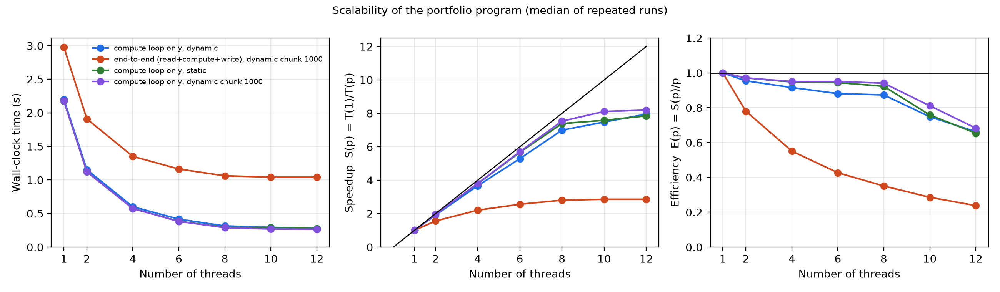

# Parallel Bond Risk: Yield-to-Maturity, Duration and Convexity with OpenMP

CS596 Scientific Computing and Visualization, final project (USC). Yen Jung (Emily) Chen.

Full title: _Parallelizing Yield-to-Maturity Solving and Interest-Rate Risk Analysis for Large Bond Portfolios_

## Abstract

**Problem.** Banks and funds hold portfolios of tens of thousands of bonds and must recompute every bond's yield to maturity (YTM) and its price sensitivity (duration and convexity) whenever interest rates move. **However, YTM has no closed-form solution, so every bond needs its own iterative solve, and it is unclear when the classic duration–convexity shortcut for repricing is still needed once parallel hardware makes full repricing cheap.**

**Finding (so far).** I implement the pipeline in C with OpenMP. At the same 10⁻⁸ tolerance, Newton–Raphson needs 4.4 iterations on average versus 27 for bisection, but is only about 1.3× faster in wall-clock time because each iteration is more expensive. The per-bond compute loop scales well: with `schedule(dynamic, 1000)` it reaches a 7.5× speedup (94% efficiency) on 8 threads for 10⁶ bonds, and the chunk size matters (7.0× with the default chunk of 1). End to end, however, reading and writing the CSV files is sequential, so the whole program speeds up only 2.8× on 8 threads, as Amdahl's law predicts (bound ≈ 3.8×). _In progress:_ the comparison of exact repricing against the duration–convexity approximation across shock sizes and maturities.

**So what.** _In progress._ The goal is a clear rule for when the cheap approximation is accurate enough and when exact (parallel) repricing is worth its cost.

## Research question and expected results

Once parallel hardware makes repricing cheap, is the duration–convexity approximation (ΔP/P ≈ −D·Δy + ½·C·Δy²) still worth using?

Hypotheses to be tested (these are expectations, not results):

1. **Accuracy.** The approximation error is third order in the shock Δy and grows with maturity, so it should be small for small shocks and large for large shocks on long bonds.
2. **Cost.** For parallel shifts of the yield curve, portfolio-level duration and convexity can be aggregated once, so each extra scenario costs O(1). Exact repricing costs O(N·S) for N bonds and S scenarios.
3. **Parallelism.** Parallel speedup narrows, but does not remove, the cost gap between exact repricing and the aggregated approximation.

## Repository layout

| File                           | Purpose                                                                                                                      |
| ------------------------------ | ---------------------------------------------------------------------------------------------------------------------------- |
| `1.ytm.c`, `1.ytm.h`           | Bond price, derivative, bisection and Newton–Raphson YTM solvers (with `_iter` variants that report iteration counts)        |
| `2.duration_convexity.c`, `.h` | Duration and convexity by central finite differences                                                                         |
| `3.gen_portfolio.py`           | Generates a synthetic portfolio `bonds.csv` (each bond priced from a known yield)                                            |
| `3.portfolio.c`                | Reads `bonds.csv`, solves YTM, duration and convexity with OpenMP, writes `results.csv`; prints compute and end-to-end times |
| `4.plot_DC_curve.py`           | Plots portfolio duration/convexity and a price–yield curve                                                                   |
| `5.convergence.c`              | Compares bisection and Newton–Raphson on the whole portfolio                                                                 |
| `6.plot_scalability.py`        | Plots time, speedup and efficiency versus thread count from `scaling.csv`                                                    |
| `6.summarize_scaling.py`       | Prints the speedup and Amdahl tables from `scaling.csv`                                                                      |
| `run_scaling.sh`               | Runs `./portfolio` for several thread counts and OpenMP schedules (5 runs each) and writes `scaling.csv`                     |
| `scaling.csv`                  | Raw scaling measurements, one row per run                                                                                    |
| `test_project.c`               | Unit tests (`make test`)                                                                                                     |
| `Makefile`                     | Build and test targets                                                                                                       |
| `fig/`                         | Figures used in this README and the report                                                                                   |
| `report/`                      | Written report                                                                                                               |

`bonds.csv` and `results.csv` are generated files and are not tracked in git.

## Requirements

- A C compiler with OpenMP. macOS: `brew install libomp` (the Makefile uses clang with libomp). Linux: `gcc`.
- Python 3 with `numpy`, `pandas` and `matplotlib` (data generation and plots). `tabulate` is optional (prettier tables in `summarize_scaling.py`).

## Build and run

```bash
make test                 # unit tests
make data N=1000000       # generate bonds.csv with N bonds
make                      # build ./portfolio and ./convergence

# Solve all bonds; prints compute time and end-to-end time, writes results.csv.
# The loop uses schedule(runtime): choose it with OMP_SCHEDULE.
OMP_SCHEDULE="dynamic,1000" OMP_NUM_THREADS=8 ./portfolio

./convergence                     # bisection vs Newton on the whole portfolio
python3 4.plot_DC_curve.py        # figures from bonds.csv and results.csv

./run_scaling.sh                  # all thread counts and schedules -> scaling.csv (about 3 minutes)
python3 6.plot_scalability.py     # fig/scaling.png
python3 6.summarize_scaling.py    # tables below
```

`run_scaling.sh` can be adjusted with environment variables, for example `THREADS="1 2 4 8" SCHEDULES="static" REPS=3 ./run_scaling.sh`. Set `APPEND=1` to add rows to an existing `scaling.csv`.

## Results so far

All numbers were measured on an Apple M4 Pro (12 cores: 8 performance, 4 efficiency). Each value is the median of five runs. "Compute" timers cover only the parallel loop; "end-to-end" covers reading `bonds.csv`, computing and writing `results.csv`.

**Sequential baseline** (one thread, compute loop only)

| N         | time (s) | µs per bond |
| --------- | -------- | ----------- |
| 1,000     | 0.002191 | 2.19        |
| 10,000    | 0.022126 | 2.21        |
| 100,000   | 0.219878 | 2.20        |
| 1,000,000 | 2.207767 | 2.21        |

The cost per bond is constant, so the time grows linearly with N.

**Compute-loop speedup S and efficiency E for three OpenMP schedules** (N = 1,000,000)

| threads | dynamic (chunk 1) S / E | static S / E  | dynamic (chunk 1000) S / E |
| ------- | ----------------------- | ------------- | -------------------------- |
| 1       | 1.00 / 100.0%           | 1.00 / 100.0% | 1.00 / 100.0%              |
| 2       | 1.91 / 95.5%            | 1.94 / 97.1%  | 1.94 / 97.2%               |
| 4       | 3.66 / 91.6%            | 3.79 / 94.8%  | 3.80 / 95.1%               |
| 6       | 5.29 / 88.2%            | 5.67 / 94.5%  | 5.70 / 95.1%               |
| 8       | 6.99 / 87.4%            | 7.39 / 92.3%  | 7.53 / 94.1%               |
| 10      | 7.48 / 74.8%            | 7.58 / 75.8%  | 8.11 / 81.1%               |
| 12      | 7.95 / 66.3%            | 7.85 / 65.4%  | 8.19 / 68.3%               |

- With the default chunk of 1, dynamic scheduling pays a scheduling cost for every bond (each bond takes only about 2 µs); handing out 1,000 bonds at a time removes most of it.
- Beyond 8 threads, dynamic scheduling with a large chunk is the best. This is consistent with the 4 slower efficiency cores, which dynamic scheduling balances automatically (not measured directly).

**End to end** (`schedule(dynamic, 1000)`, N = 1,000,000)

| threads | total (s) | read (s) | compute (s) | write (s) | speedup | Amdahl predicted |
| ------- | --------- | -------- | ----------- | --------- | ------- | ---------------- |
| 1       | 2.978     | 0.340    | 2.179       | 0.452     | 1.00    | 1.00             |
| 2       | 1.909     | 0.333    | 1.121       | 0.459     | 1.56    | 1.58             |
| 4       | 1.351     | 0.326    | 0.573       | 0.450     | 2.20    | 2.23             |
| 6       | 1.163     | 0.328    | 0.382       | 0.450     | 2.56    | 2.58             |
| 8       | 1.061     | 0.326    | 0.289       | 0.442     | 2.81    | 2.80             |
| 10      | 1.042     | 0.325    | 0.269       | 0.443     | 2.86    | 2.95             |
| 12      | 1.042     | 0.329    | 0.266       | 0.446     | 2.86    | 3.06             |

Reading and writing the CSV files take about 0.79 s regardless of the thread count (26.6% of the single-thread run). With s = 0.266, Amdahl's law gives a speedup bound of 1/s ≈ 3.8×. The prediction `1 / (s + (1 − s)/p)` uses only the one-thread run and matches the measurement at 8 threads (2.80 vs 2.81); at 12 threads it is optimistic because the compute loop itself is then only 68% efficient.



**Bisection vs Newton–Raphson** (N = 100,000, tolerance 1e-8 for both)

| method    | avg iterations | max iterations | time (s) | max abs error vs true YTM |
| --------- | -------------- | -------------- | -------- | ------------------------- |
| bisection | 27.00          | 27             | 0.185039 | 7.451e-09                 |
| newton    | 4.43           | 7              | 0.139508 | 1.407e-15                 |

Newton needs about 6× fewer iterations but is only about 1.3× faster in wall-clock time, because each iteration evaluates both the price and its derivative.

## Method notes

- Bond: level coupon `C` per period, face value `F`, `n` periods, price `P(y) = Σ C/(1+y)^t + F/(1+y)^n`. The code uses one payment per period (`m = 1`): `years` is the number of periods and `y` is the per-period yield.
- YTM is the root of `f(y) = P(y) − P_market`. Bisection brackets the root in [0, 1]; Newton–Raphson starts from 5%.
- Duration and convexity use central differences with `h = 1e-4`:
  `D = (P₋ − P₊)/(2·P₀·h)`, `C = (P₋ + P₊ − 2·P₀)/(P₀·h²)`.
- The per-bond computations are independent, so the loop uses `#pragma omp parallel for schedule(runtime)`. The schedule is chosen with `OMP_SCHEDULE`; the best setting found is `dynamic,1000`.
- `results.csv` stores the YTM with 12 decimals.

## Limitations

- Synthetic portfolio, level coupons, flat per-bond yield, no day-count conventions or accrued interest.
- Only parallel shifts of the yield are considered for the approximation.
- Timings are from one machine and one compiler configuration. Reading and writing CSV files is sequential and limits the end-to-end speedup.
